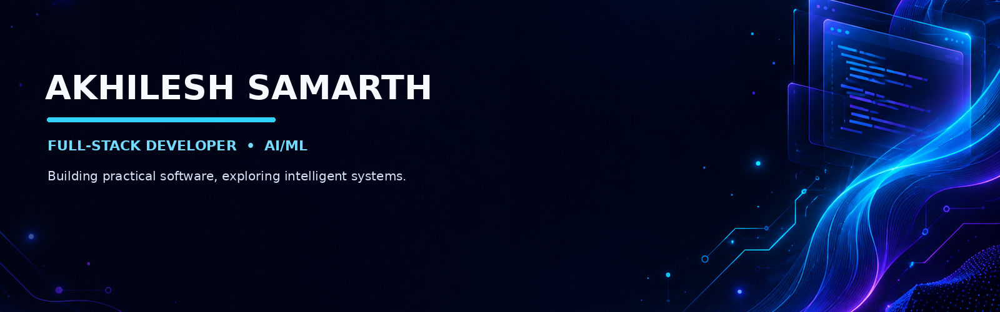

  
  
  

### `Building • Learning • Shipping`

---

## 👋 A little about me

I'm **Akhilesh Samarth**, a Computer Science and Engineering graduate from **NIT Andhra Pradesh**. I enjoy creating full-stack applications, exploring AI/ML, and turning technical ideas into useful products.

- 🌐 **Web:** React, Node.js, Express, MongoDB, TypeScript
- 🤖 **AI/ML:** Machine Learning, Deep Learning, NLP, RAG, FAISS, Hugging Face
- 🧠 **Core CS:** Data Structures & Algorithms, OOP, DBMS, SQL
- 🚀 I like building practical projects and continuously improving my engineering skills.

---

## 🧰 My toolkit

  

  

  
  
  
  
  
  

---

## 🚀 Featured projects

<table>
<tr>
<td width="50%" valign="top">

### 🩺 MediBot.AI
An AI-powered medical question-answering project using retrieval-augmented generation to retrieve relevant medical content and produce context-aware responses.

**Built with:** Python · LangChain · FAISS · Hugging Face Embeddings · Mistral · Streamlit

<a href="https://github.com/akhilesh146?tab=repositories">Explore repositories →</a>

</td>
<td width="50%" valign="top">

### 🌐 ZYNC
A career portal for the NIT Andhra Pradesh community that centralizes internship and job opportunities, with separate permissions for students and administrators.

**Built with:** React · TypeScript · Tailwind CSS · Node.js · Appwrite · Vite

<a href="https://github.com/akhilesh146?tab=repositories">Explore repositories →</a>

</td>
</tr>
<tr>
<td width="50%" valign="top">

### 🏡 Accommodation Booking Platform
A lodging platform with backend data models for users, properties, bookings, and reviews, designed around a straightforward booking experience.

**Built with:** Node.js · Express.js · MongoDB · EJS · Bootstrap · JavaScript

<a href="https://github.com/akhilesh146?tab=repositories">Explore repositories →</a>

</td>
<td width="50%" valign="top">

### 🔎 More experiments
I also explore data analysis, machine learning, and web development through smaller projects and learning repositories.

<a href="https://github.com/akhilesh146?tab=repositories">Browse all repositories →</a>

</td>
</tr>
</table>

> **Project links:** The descriptions above come from my résumé. Replace the general repository links with each exact repository URL when ready.

---

## 📈 GitHub activity

  
  

  

---

## 🏆 Certifications & milestones

- 🟢 **Fundamentals of Deep Learning** — NVIDIA
- 🟢 **Building Transformer-Based NLP Applications** — NVIDIA
- 🚀 **Zonalist at Eureka** — IIT Bombay
- 💻 **GATE CS — AIR 7807**
- 🤝 **Executive Member** — E-Yantra Club, NIT Andhra Pradesh

---

## 🤝 Let's connect

I'm happy to connect with developers, exchange ideas, and learn about interesting projects.

  
  <!-- Replace the placeholder below with your actual LinkedIn profile URL -->
  

*Thanks for visiting my profile — have a great day! ✨*

